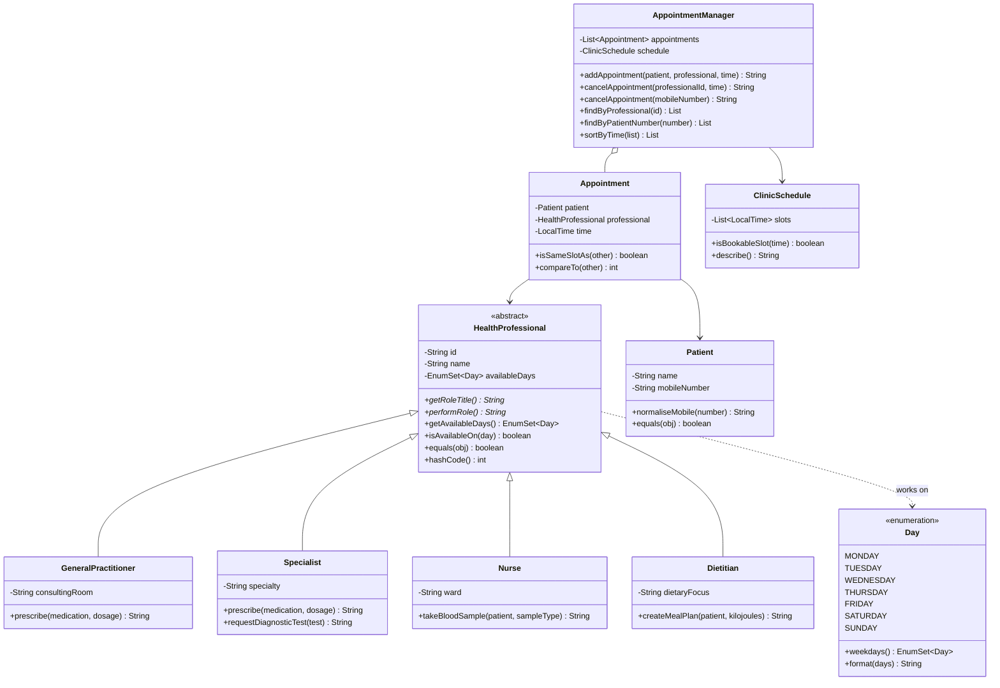

# PROG2004 Assessment 1 — Health Service Appointment System

| | |
|---|---|
| **Student** | Zhang Yanming (25259706) |
| **Unit** | PROG2004 Object Oriented Programming |
| **Assessment** | 1 — Portfolio / programming (40%) |
| **Language** | Java 21 (built and tested with OpenJDK 21.0.10) |

## 1. What this program is

A set of collaborating classes that model the backbone of a health service appointment
system: health professionals of several kinds, patients, appointments, and the manager that
holds them together. There is deliberately no user interface, no menu and no persistence — as
the brief requires, `AssignmentOne.main` acts as a scripted simulation that creates objects,
exercises their behaviour and prints the results to the console.

## 2. Progress

| Part | Scope | Status |
|---|---|---|
| 1 | Modelling a generic health professional | done |
| 2 | Specialising into GP / Specialist / Nurse / Dietitian | done |
| 3 | Working with the objects polymorphically in `main` | done |
| 4 | Modelling an appointment (patient, time, professional) | done |
| 5 | Managing the collection of appointments | done |
| 6 | End-to-end demonstration, including error cases | done |

## 3. How to build and run

```bash
javac -d out src/*.java
java -cp out AssignmentOne
```

Expected output is 400+ lines: a banner, the nine professionals with their duties, then the
appointment system, with each operation reporting its result.

## 4. Class design



## 5. Design decisions and why

| # | Decision | Alternative rejected | Reason |
|---|---|---|---|
| 1 | `HealthProfessional` is **abstract** and declares two abstract methods (`getRoleTitle`, `performRole`) | a concrete "generic" professional | The service never employs a professional with no specialty, so such an object should be impossible to create; the abstract method also forces every subclass to state what it does, which keeps the hierarchy honest as it grows. |
| 2 | Weekly roster stored as `EnumSet<Day>`, and `Day` is an `enum` | `String[]`, `List<String>`, `boolean` flags | The set of days is a fixed vocabulary, so invalid values become unrepresentable; `EnumSet` is a set (no duplicates, order irrelevant) and iterates in declaration order, which makes the printed roster stable. |
| 3 | `getAvailableDays()` returns a **copy** | returning the internal set | Otherwise external code could silently rewrite a professional's roster and break the invariant that the object is always valid. |
| 4 | ID kept as `String`, validated against `\d+` | `int` | An identifier is a label, not a quantity: it is never added or compared numerically, and leading zeros must survive. Validation still enforces "numbers only". |
| 5 | Two constructors per class (full and shortened) | one constructor only | Most professionals work a standard week, so the shortened form removes noise at the call site. The full form still exists for part-timers. |
| 6 | `toString()` overridden, subclasses append to `super.toString()` | a separate `print()` method | The brief asks that printing an object shows its details; overriding `toString` is the Java idiom and lets a whole collection be printed in one loop. Appending to `super.toString()` reuses the shared block instead of duplicating it. |
| 7 | Shared formatting in `ConsoleFormat`, shared validation in `Validation` | repeating `printf` and `if (x == null)` in every class | Both rules are needed by the professional hierarchy, the patient and the appointment. Expressing each once means every class prints and rejects input the same way. |
| 8 | Invalid input rejected with `IllegalArgumentException` in the constructor | accepting anything and validating later | An object that exists is always valid, which removes a whole class of "check before you use it" logic from the rest of the program. |
| 9 | `equals`/`hashCode` on `HealthProfessional` based on the ID, on `Patient` based on the mobile number | default reference equality | Two objects holding the same identifier are the same person as far as the service is concerned. This is what allows Part 5 to detect a double booking. |
| 10 | `Patient` is its own class | two `String` fields inside `Appointment` | A patient exists before any appointment, can hold several, and owns the rule that decides whether a mobile number is valid — so the rule is written once and cannot be bypassed. |
| 11 | Appointment time is a `LocalTime` | `String`, `int`, `Date` | `LocalTime` is already `Comparable`, so ordering the day is correct by construction instead of relying on text that happens to sort well until the clinic switches to a 12 hour clock. |
| 12 | `Appointment` implements `Comparable<Appointment>` with the professional ID as tie-break | sorting in the caller with ad hoc comparisons | The ordering rule belongs to the type being ordered; a stable tie-break also makes the demonstration identical on every run. |
| 13 | Slot validity and double booking are enforced by `AppointmentManager`, not by `Appointment` | every appointment validating against a global schedule | Both checks need a view of the whole clinic (its hours, and everyone's bookings), which a single appointment does not have. Keeping them in the manager also means the schedule can change without touching `Appointment`. |
| 14 | `AppointmentManager` uses an `ArrayList` | `HashSet`, `HashMap` keyed by professional | The day is iterated in booking order and sorted often; two appointments at the same time for different professionals must both be storable; "show me the whole day" is a plain iteration. The collection is tiny, so linear scans are not a concern. |
| 15 | Every manager operation returns a message | methods that print, or that return `void` | The manager should not decide how the clinic talks to its staff, and returning the outcome makes the operations easy to test and to reuse behind a future UI. |
| 16 | `ClinicSchedule` built from opening time, closing time and slot length | a hard coded array of 16 times | Changing the clinic's hours becomes a one line change that every other class picks up, which is what Part 5 asks for. |

## 6. Assessment mapping

Each rubric criterion, and where the evidence for it lives in this repository:

- **Part 1 (10%)** — `HealthProfessional`, `Day`
- **Part 2 (20%)** — the abstract contract plus `GeneralPractitioner`, `Specialist`, `Nurse`, `Dietitian`
- **Part 3 (10%)** — `AssignmentOne.demonstrateProfessionals`
- **Part 4 (15%)** — `Patient`, `Appointment`
- **Part 5 (15%)** — `AppointmentManager`, `ClinicSchedule`
- **Part 6 (10%)** — `AssignmentOne.demonstrateAppointmentSystem`
- **Video (10%)** — four pillars walkthrough; script in `docs/A1-视频演讲稿与演示流程.docx`
- **Professional practice (10%)** — this repository's commit history, the WakaTime report and the Javadoc throughout

## 7. The four pillars, and where to find them

| Pillar | Where | What to say |
|---|---|---|
| Encapsulation | `HealthProfessional` fields, `Patient.normaliseMobile`, `Validation` | State is private and only reachable through validated operations, so invalid objects cannot be built. |
| Abstraction | `HealthProfessional` (abstract) + `AppointmentManager`'s API | The abstract class names what every professional must be able to do without saying how; the manager hides the collection behind operations like `addAppointment`. |
| Inheritance | the four subclasses and `super.toString()` | Shared identity, roster and printing are written once in the base class and reused by all four types. |
| Polymorphism | `List<HealthProfessional>` in `AssignmentOne`, `Appointment.compareTo` | One loop calls `toString()` and `performRole()` and gets four different behaviours; `compareTo` lets any list sort itself. |
