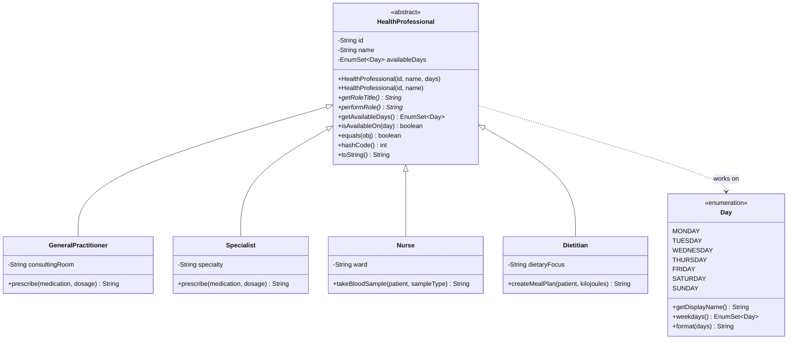

# PROG2004 Assessment 1 — Health Service Appointment System

| | |
|---|---|
| **Student** | Zhang Yanming (25259706) |
| **Unit** | PROG2004 Object Oriented Programming |
| **Assessment** | 1 — Portfolio / programming (40%) |
| **Language** | Java 21 (built and tested with OpenJDK 21.0.10) |

## 1. What this program is

A set of collaborating classes that model the backbone of a health service appointment
system: health professionals of several kinds, patients, appointments, and the manager that
holds them together. There is deliberately no user interface, no menu and no persistence — as
the brief requires, `AssignmentOne.main` acts as a scripted simulation that creates objects,
exercises their behaviour and prints the results to the console.

## 2. Progress

| Part | Scope | Status |
|---|---|---|
| 1 | Modelling a generic health professional | done |
| 2 | Specialising into GP / Specialist / Nurse / Dietitian | in progress |
| 3 | Working with the objects polymorphically in `main` | planned |
| 4 | Modelling an appointment (patient, time, professional) | planned |
| 5 | Managing the collection of appointments | planned |
| 6 | End-to-end demonstration, including error cases | planned |

## 3. How to build and run

```bash
javac -d out src/*.java
java -cp out AssignmentOne
```

## 4. Class design (Parts 1–2)



The appointment side (Parts 4–6) is not shown yet; it is added in the next commit series.

## 5. Design decisions and why

| # | Decision | Alternative rejected | Reason |
|---|---|---|---|
| 1 | `HealthProfessional` is **abstract** and declares two abstract methods (`getRoleTitle`, `performRole`) | a concrete "generic" professional | The service never employs a professional with no specialty, so such an object should be impossible to create; the abstract method also forces every subclass to state what it does, which keeps the hierarchy honest as it grows. |
| 2 | Weekly roster stored as `EnumSet<Day>`, and `Day` is an `enum` | `String[]`, `List<String>`, `boolean` flags | The set of days is a fixed vocabulary, so invalid values become unrepresentable; `EnumSet` is a set (no duplicates, order irrelevant) and iterates in declaration order, which makes the printed roster stable. |
| 3 | `getAvailableDays()` returns a **copy** | returning the internal set | Otherwise external code could silently rewrite a professional's roster and break the invariant that the object is always valid. |
| 4 | ID kept as `String`, validated against `\d+` | `int` | An identifier is a label, not a quantity: it is never added or compared numerically, and leading zeros must survive. Validation still enforces "numbers only". |
| 5 | Two constructors per class (full and shortened) | one constructor only | Most professionals work a standard week, so the shortened form removes noise at the call site. The full form still exists for part-timers. |
| 6 | `toString()` overridden, subclasses append to `super.toString()` | a separate `print()` method | The brief asks that printing an object shows its details; overriding `toString` is the Java idiom and lets a whole collection be printed in one loop. Appending to `super.toString()` reuses the shared block instead of duplicating it. |
| 7 | Shared field formatting factored into `appendField(...)` | repeating `printf` in each subclass | Label alignment is defined in exactly one place, so all four subclasses print consistently. |
| 8 | Invalid input rejected with `IllegalArgumentException` in the constructor | accepting anything and validating later | An object that exists is always valid, which removes a whole class of "check before you use it" logic from the rest of the program. |
| 9 | `equals`/`hashCode` based on the ID only | default reference equality | Two objects holding the same ID are the same person as far as the service is concerned. This is what allows Part 5 to detect a double booking. |

## 6. Assessment mapping

Each rubric criterion, and where the evidence for it lives in this repository:

- **Part 1 (10%)** — `HealthProfessional`, `Day`
- **Part 2 (20%)** — `HealthProfessional` abstract contract + the four subclasses
- **Part 3 (10%)** — the polymorphism block in `AssignmentOne.main`
- **Part 4 (15%)** — `Patient`, `Appointment`
- **Part 5 (15%)** — `AppointmentManager`, `ClinicSchedule`
- **Part 6 (10%)** — the demonstration block in `AssignmentOne.main`
- **Video (10%)** — four pillars walkthrough, linked in the Blackboard submission comments
- **Professional practice (10%)** — this repository's commit history, WakaTime report and Javadoc
